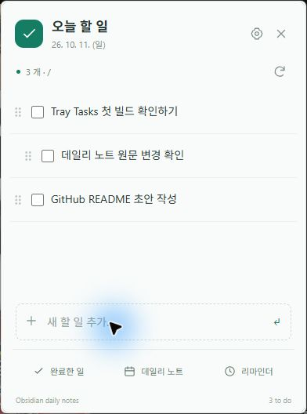

# Tray Tasks

Your Obsidian daily tasks, one click away.

A Windows tray app that reads and edits the checkboxes in your daily notes. Obsidian can stay closed.

**0.1.0 — development preview.** [한국어 안내](README.ko.md)



## What it does

- Add, rename, complete, reopen and delete tasks, including nested items.
- Drag tasks to change their display order without rearranging your Markdown.
- Postpone to tomorrow, the same weekday next week, or a date you choose.
- Set reminders through tomorrow at 23:59, with grouped alerts and configurable repeats.
- Carry unfinished tasks across midnight while keeping their reminder times.
- Start quietly when signing in to Windows.
- Korean and English UI, custom tray icons, fonts, accent color and compact window settings.

Manual postponement cancels reminders. Midnight rollover preserves the exact scheduled time.

## First run

1. Run the Windows installer, then open Tray Tasks.
2. In Obsidian, enable **Core plugins → Daily notes**. Set the date format to **YYYY-MM-DD**.
3. Choose your vault and the matching daily-note folder in Tray Tasks. Leave the folder blank for the vault root.
4. Confirm the Daily Notes setup and save. Use the icon in the notification area to open your task list.

The folder picker reads Obsidian's Daily Notes folder when its configuration exists. You can also enter it manually. Windows may initially put the tray icon in its overflow menu.

Existing notes are kept. Missing notes are created as empty UTF-8 files. Note templates are not executed.

## Markdown and local data

Tasks receive an identifier such as:

```md
- [ ] Write the README <!-- tray-tasks:9f53db32-1c7c-4b39-8992-e7748a04d336 -->
```

The comment is present in Markdown source and hidden in Obsidian's reading view. Manual postponement leaves a history line:

```md
- [>] Write the README <!-- tray-tasks:... --> → [[2026-10-12]]
```

Preferences, display order, reminders and backups stay outside your vault in the app's local data folder. Open it from Settings. The usual Windows location is `%LOCALAPPDATA%\com.traytasks.obsidian`.

Edits use a backup, a temporary file and a check for external changes. Moves use a recovery journal. These checks do not provide a shared lock with external editors or merge sync conflicts. See [architecture](docs/architecture.md).

## Development

Install Node.js 22.12 or newer, Rust stable (MSVC), Visual Studio C++ tools and Windows SDK. Windows WebView2 is also required.

```powershell
npm ci
npm run desktop:dev
```

The desktop wrapper discovers Visual Studio and loads its compiler environment.

```powershell
npm test
npm run desktop:test
npm run desktop:check
npm run build
npm run desktop:build
```

The installer is created under `src-tauri/target/release/bundle/nsis`.

For a browser-only UI preview, run `npm run dev` and open `http://127.0.0.1:1420/?preview`. Preview changes never access a vault.

[Verification and remaining manual checks](docs/testing.md) · [Changelog](CHANGELOG.md)

## Current scope

Windows only. Daily-note filenames must use YYYY-MM-DD. No template execution, cloud sync, conflict merging or dependency on Obsidian Tasks/Reminder plugins. Settings and reminders are specific to this computer. This preview has not yet completed reboot, installer upgrade and multiple-monitor acceptance testing.
